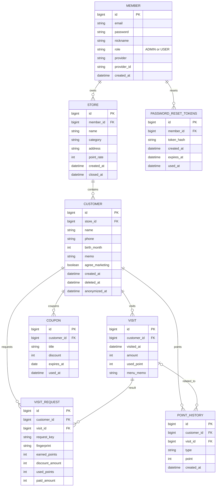

# 현재 구현 기준 논리 ERD

2026-11-27 엔티티 소스 기준입니다. 주요 필드를 나타낸 논리 모델이며 실제 운영 DB 컬럼·제약 적용 여부를 보장하는 스키마 덤프는 아닙니다.

## 현재 모델과 정책

- Member의 역할은 ADMIN·USER입니다. OWNER는 사장님의 업무상 이름이며 enum 교체는 현재 범위가 아닙니다.
- 회원 1명은 매장 0..N개를 소유합니다. `store.member_id`에 단일 UNIQUE 제약을 두지 않습니다. 소유자는 필수이며 JPA 관계는 ManyToOne입니다.
- Member에 승인·정지 status 필드는 없습니다. Store도 승인 상태 컬럼을 쓰지 않고 `closed_at` 유무로 OPEN/CLOSED를 계산합니다.
- Visit.amount는 할인·포인트 사용 후 실결제 금액(정수 원 단위)입니다. Coupon.discount도 정수 원 단위이며 expires_at은 날짜입니다.
- PointHistory.visit는 선택 관계입니다. 방문 삭제 시 SET NULL 매핑이 있으며 포인트 잔액은 적립·사용 이력으로 계산합니다.
- 고객 소프트 삭제·주요 정보 제거 후에도 고객 ID와 거래 관계를 보존해 과거 집계를 유지합니다. 완전한 익명화를 의미하지 않습니다.
- VisitRequest는 고객·요청 키 UNIQUE와 최초 처리 결과를 보존합니다. 고객·방문 물리 삭제 시 CASCADE하며, 배포 전에 추가 테이블 SQL이 필요합니다. [재전송 정책](15_방문_요청_재전송_정책.md)을 따릅니다.
- 비밀번호 재설정 토큰은 별도 엔티티에서 해시·만료·사용 시각을 관리합니다.
- 매장 소유권은 서버에서 검증합니다. 현재 API·오류 계약은 [API 문서](05_SaaS_API.md), 개인정보와 폐업 정책은 [고객 삭제](07_고객_삭제_정책.md)·[매장 폐업](10_매장_폐업_정책.md)을 따릅니다.

## 초기 설계와의 차이

초기 OWNER enum과 PENDING/ACTIVE/SUSPENDED 승인 흐름은 현재 범위에서 제외했습니다. 과거 기획은 [초기 공식 설계](00_SaaS_공식설계_v1.md)에 보존합니다. 현재 엔티티에 없는 필드를 운영 DB에 추가하라는 지침이 아닙니다. 운영은 validate를 사용하므로 실제 변경은 SQL 안내와 엔티티를 대조해 적용합니다.
