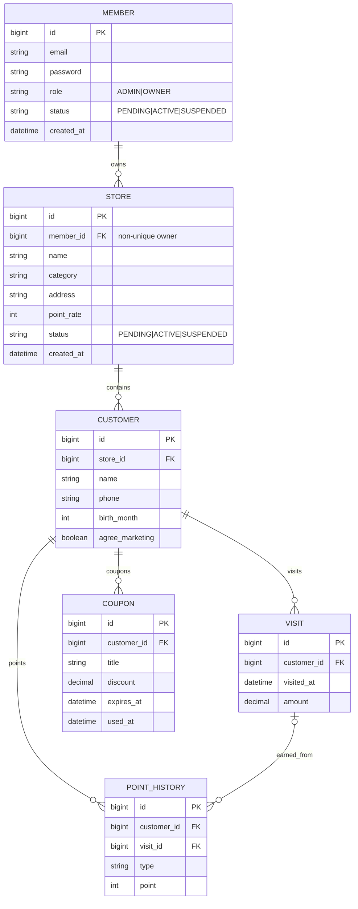

# SaaS 논리 ERD v1 (설계안)

## 데이터 모델 결정
- `Member(OWNER)` 1 : N `Store` 확정: 한 OWNER가 여러 매장을 소유할 수 있다. ADMIN은 Store 없이 존재 가능하며 OWNER도 승인 전 매장 0개일 수 있다. `store.member_id`에 UNIQUE 제약을 두지 않는다.
- `member.role`: 현재 `USER` → 목표 `OWNER`로 마이그레이션. DB 기존 값이 있다면 무작정 enum 변경하지 말고 데이터 변환 migration 작성.
- `member.status`, `store.status` 추가. ADMIN 생성 시 store 생성하지 않음.
- 계정·매장 등록 및 승인 시 중복 이메일, 매장 소유권 및 접근 권한, 상태 전이 검증.
- OWNER는 자기 매장 고객만 조회. DB FK 및 인덱스: `customer(store_id)`, `visit(customer_id, visited_at)`, `coupon(customer_id)` 등.
- 이 문서는 **논리 설계**이며 실제 SQL migration과 엔티티 코드는 별도 구현 필요.

- 매장별 데이터 격리: CUSTOMER.store_id 기준으로 조회·수정·삭제 범위를 제한한다. 요청 storeId가 소유 매장 목록에 속하는지 서버에서 검증한다.
